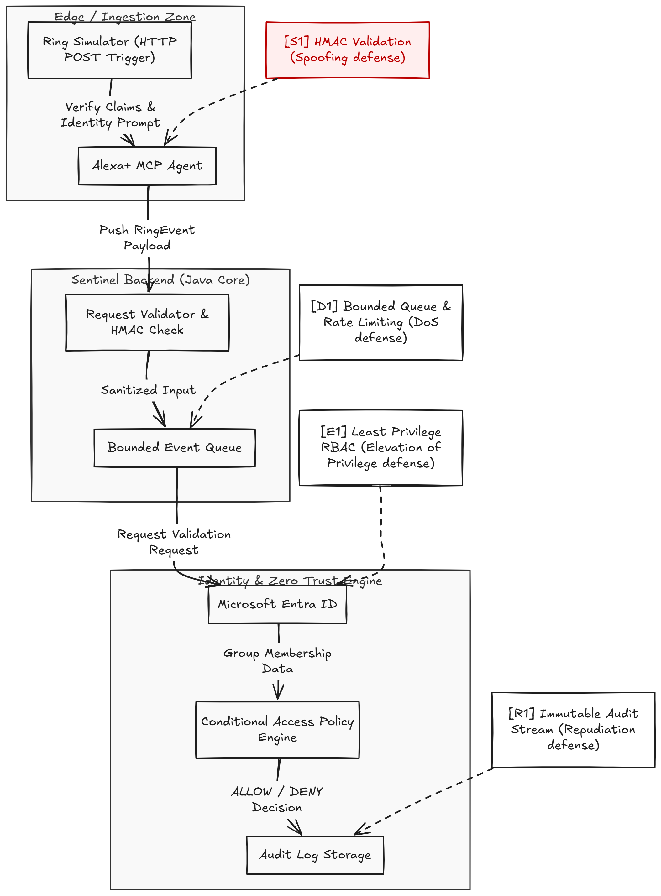

# Zero-Trust Sentinel 🛡️

**Zero-Trust Sentinel** is a physical access control engine that integrates Ring event triggers, Alexa+ Model Context Protocol (MCP) agents, and Microsoft Entra ID conditional access controls to evaluate physical site security requests.



## Core Architectural Pillars

1. **Ingestion & Agentic Layer (Alexa+ MCP):** Receives natural device triggers and exposes a standardized Model Context Protocol JSON-RPC tool schema (`verify_door_access`).
2. **Cryptographic Integrity & Rate Limiting:**
    * **[S1] HMAC-SHA256 Validation:** Prevents payload spoofing and tampering before ingestion.
    * **[D1] Bounded Event Queue:** Utilizes a thread-safe `ArrayBlockingQueue` to buffer incoming requests and mitigate Denial of Service (DoS) floods.
3. **Identity & Zero Trust Engine:**
    * **[E1] Role-Based Access Control (RBAC):** Cross-references user identity claims against Microsoft Entra ID group permissions.
    * **[R1] Immutable Audit Stream:** Generates unique correlation IDs and detailed logs for every access decision.

---

## Threat Model (STRIDE Methodology)

| Threat Category | Target Vector | Zero Trust Sentinel Mitigation |
| :--- | :--- | :--- |
| **Spoofing** | Forged Ring doorbell payload | HMAC-SHA256 signature verification |
| **Tampering** | Modified JSON claims in transit | Payload hash comparison in `HmacValidator` |
| **Repudiation** | Denied access attempt claims | Append-only structured audit logs with correlation IDs |
| **Denial of Service** | High-frequency API request floods | In-memory `EventQueueProcessor` rate-limiting queue |
| **Elevation of Privilege** | Unauthorized door access attempt | Strict Entra ID group claim matching in `PolicyEngine` |

---

## Tool & Tech Stack

* **Language & Runtime:** Java 21+ / JDK 25, Apache Maven
* **IDE:** IntelliJ IDEA Ultimate
* **Integration Standards:** Alexa+ Model Context Protocol (MCP)
* **Identity Management:** Microsoft Entra ID (Azure AD) RBAC Simulation
* **Version Control:** Git & GitHub

---

## Quickstart & Verification

1. **Clone the repository:**
   ```bash
   git clone [https://github.com/ttp-odoi/Zero-Trust-Sentinel.git](https://github.com/ttp-odoi/Zero-Trust-Sentinel.git)
   cd Zero-Trust-Sentinel